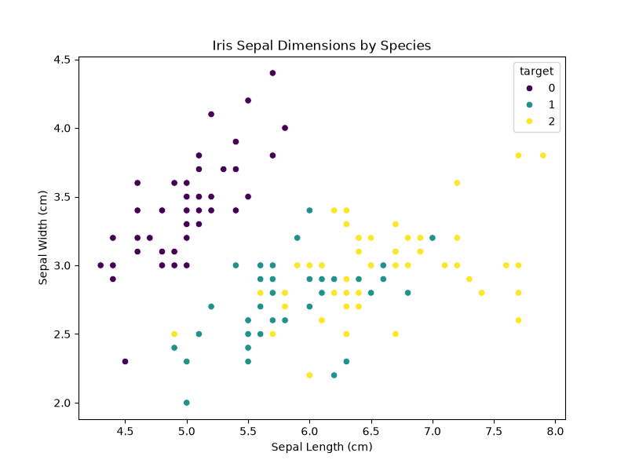

# Ji Fanxi (jifanxi0020) - Data Science Portfolio

## Introduction
Hello! I am a data science student at the University of Macau. I am passionate about extracting insights from data to solve real-world problems.

## Technical Skills
- **Programming:** Python, SQL
- **Data Analysis:** Pandas, NumPy
- **Machine Learning:** Scikit-learn
- **Visualization:** Matplotlib, Seaborn

## Project Showcase

### Iris Species Classification Analysis
- **Research Question:** This project aims to build a predictive model to classify Iris flower species based on their dimensions.
- **Findings & Visualization:** 
  
  *Brief explanation:* The scatter plot shows the relationship between sepal length and width. It clearly demonstrates that the Setosa species (purple dots) is linearly separable from the other two species based on these dimensions.
- **Project Repository:** [https://github.com/jifanxi0020/data-science-project](https://github.com/jifanxi0020/data-science-project)
- **Project Status:** Completed
